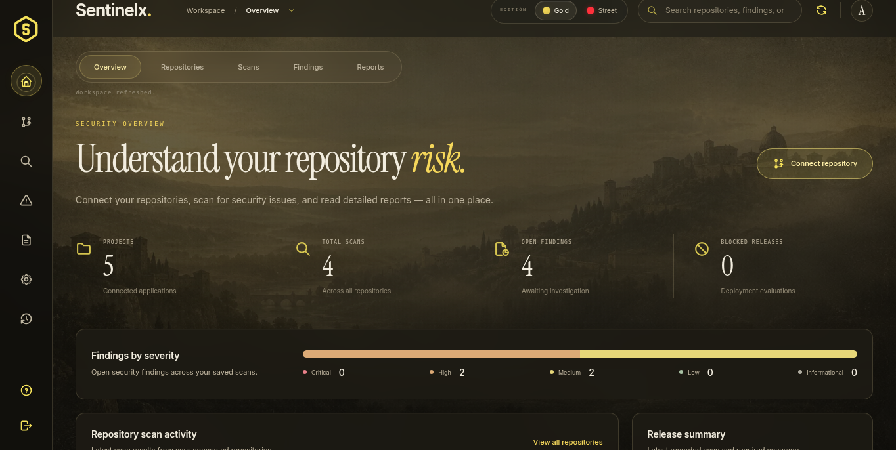

# Sentinelx

A PostgreSQL-backed security dashboard for connecting public GitHub repositories or uploading source ZIPs, running baseline security checks, and reviewing findings, policy decisions and reports. Includes a separate platform-administrator portal and working project/repository Create, Read, Update, Delete and Search operations.

[CRUD demonstration](docs/crud-demo.md) · [Final delivery guide](docs/final-delivery.md) · [Deployment](docs/deployment.md) · [Testing](docs/testing.md)



## Run on Windows

Install and start Docker Desktop for PostgreSQL. Extract the project, double-click **Start-Sentinelx.cmd**, and keep its terminal open. Open `http://127.0.0.1:8000` for the dashboard. If you have an old server running, stop it with Ctrl+C before restarting the updated application. Your existing `data/` database and `.venv/` can be retained.

Create an account, choose **Connect repository**, enter a public GitHub repository and its branch, then start a scan. You can also upload a ZIP. Findings and reports use real backend results. Private GitHub OAuth and full external security scanner suites remain future integrations; the dashboard clearly displays current coverage.

## Product overview

Sentinelx is a backend foundation for a DevSecOps security control center: authenticate, create a project, connect a GitHub repository, scan source, review normalized findings, evaluate a policy, and retrieve a report. The browser dashboard is served by the same application at `/`. Register or sign in, connect a public GitHub repository, run a scan, and read or download the report without API commands.

## Run locally

Requires Python 3.12 or later. From this checkout:

```sh
python3 -m venv .venv
.venv/bin/pip install -r requirements.lock
.venv/bin/python scripts/start.py
```

The launcher generates a local database password only when .env is absent, starts PostgreSQL in Docker, and uses DATABASE_URL. Existing .env settings are preserved. SQLite remains supported for legacy data and isolated tests; new default deployment uses PostgreSQL. Open `/` for the dashboard. Developer API documentation remains available at `/docs`. Health is available at `GET /health`.

Run unit, integration, security and real HTTP smoke checks with `bash scripts/check.sh`. See [testing workflow](docs/testing.md) for TDD evidence and adversarial testing scope.

## Run with Docker Compose

```sh
docker compose up --build -d --wait
docker compose logs -f api
```

Initialize local .env first with the launcher (or securely configure POSTGRES_PASSWORD). The API binds to the host loopback interface on port8000. PostgreSQL state is retained in `sentinelx-postgres`; the legacy `secureflow-data` SQLite volume is retained for migration. `docker compose down` retains state; adding `--volumes` deletes it. The container runs without root privileges and has a read-only root filesystem, a bounded temporary filesystem, and no Linux capabilities.

This configuration is intended for local evaluation. Before exposing it publicly, add HTTPS ingress, shared ingress rate limiting, account provisioning controls, resource quotas, monitoring, backups, and isolated scan workers. No cloud service is provisioned by these files.

## API workflow

1. Register an account and sign in. The browser receives an expiring HttpOnly session cookie; native API clients can use the returned bearer token.
2. Create a project in that authenticated workspace.
3. Connect its GitHub repository with the HTTPS repository URL and branch.
4. Start a scan and poll its status until completed or failed.
5. Read the findings, gates, policy decision, and scan report.
6. Record a deployment decision only after the scan has completed. A deployment record does not execute a deployment.

Endpoints are under `/api/v1`: `/auth/register`, `/auth/login`, `/projects`, `/repositories`, `/scans`, and `/scans/{scan_id}/report`. A project ZIP can be submitted as multipart data to `/projects/{project_id}/upload` (20 MiB limit).

The browser dashboard uses same-origin session cookies. Native clients can use `Authorization: Bearer <access_token>`; cookie-authenticated write requests must provide matching same-origin evidence. Never commit tokens or log authorization/cookie headers. Registration creates an administrator of that account's own workspace. Each account's resources are isolated by ownership; this initial backend is not a shared organization/tenant collaboration system.

## PHP runtime advisories

New scans detect declared PHP runtimes and match a reviewed offline catalog for **CVE-2026-109618** and **CVE-2026-109619**. Reports include evidence locations, confidence and patched-version guidance. Floating versions and Composer requirements remain unknown rather than being called safe. See [PHP runtime checks](docs/php-runtime-scanning.md) for supported inputs and limitations. This is a two-advisory runtime check, not a general dependency/container scanner.

## Scan scope

Source files are treated as untrusted data. The scanner does not install repository dependencies, run project code, run Git hooks, build containers, or deploy workloads. Source acquisition is restricted to GitHub HTTPS and archive contents are bounded and validated before inspection.

The built-in scanners are limited heuristics for potential exposed secrets, Python source issues, and infrastructure/container configuration issues. Their findings are leads for human review. A clean heuristic scan is not evidence that the application is vulnerability-free. Full Gitleaks, Semgrep/CodeQL, dependency CVE intelligence, Checkov, Trivy, and ZAP integrations are separate future work unless explicitly identified as executed in a scan result. Private GitHub account OAuth/App authorization and GitHub Actions orchestration are not implemented by merely connecting a public repository URL.

The unconfigured SCA, container-image, and DAST gates are explicitly reported as NOT_CONFIGURED and block release by default. Risk scores and PASS/WARN/BLOCK outcomes come from recorded findings and policy. Unavailable/failed checks must remain visible; do not interpret a skipped engine as a passed engine. Security reports contain metadata and remediation guidance, not detected secret values.

## Operational limits

Scans run within the API process for this first version. Use one worker. Process restarts interrupt scans; startup marks interrupted queued/running scans failed with a BLOCK decision. This is not a durable distributed job queue. Public deployment needs a separate queue/worker service and sandbox isolation before adding tools that execute untrusted code. PostgreSQL is the normal deployment database; SQLite remains available for offline compatibility. Production still needs retention, backup and worker scaling plans.

See [architecture](docs/architecture.md) for implementation boundaries and the tested restricted-builder offline wheel workaround.

Authentication requests have a bounded per-peer in-memory throttle (default 30 requests per minute, shared across login and registration). See `.env.example` for configuration and [testing](docs/testing.md) for its limits and verification. Direct startup disables proxy header handling to prevent forwarded-header identity spoofing.

## Platform administrator portal

On Windows, double-click **Create-Admin.cmd** once to provision your administrator using hidden password prompts; then run **Start-Sentinelx.cmd**. Docker Desktop must be running. If importing legacy SQLite data, do that before creating any PostgreSQL accounts.

Open `/admin` for the separate administrator login. Public registration cannot create a platform administrator. Bootstrap one using `.venv/bin/python scripts/start.py create-admin` (Windows: `.\.venv\Scripts\python.exe scripts\start.py create-admin`). Email and password are prompted; the password is hidden. Admins can review cross-account repositories/scans/reports/audits, update workspace roles and disable/re-enable accounts. Disabled accounts lose active sessions. Platform administrator membership is managed by the local operator only.

To preserve existing SQLite users/projects/scans, run `.venv/bin/python scripts/start.py migrate data/secureflow.db` before creating an administrator or user in a new PostgreSQL database. This imports only into an empty target, leaves SQLite untouched, and requires users to sign in again. Back up the source first. See [administrator and PostgreSQL guide](docs/admin-postgres.md).

## Hosting

Prepared deployment options are documented in [deployment guide](docs/deployment.md): a standalone Docker/Caddy HTTPS stack and an optional Render blueprint with managed PostgreSQL. These files have not provisioned a public host. Production uses `SENTINELX_ENV=production`, a secret PostgreSQL `DATABASE_URL`, secure cookies, and the exact HTTPS public origin; it must not fall back to SQLite. Keep one API worker/instance for the current in-process scan workflow. Vercel alone does not supply the persistent backend this version needs.

## Reopening dashboards

Both workspace and administrator sessions now restore through separate HttpOnly SameSite cookies, valid for eight hours. Reopening or refreshing the browser reloads the existing account's PostgreSQL records. After expiration, sign in with the same account; projects and scans remain stored. Logout explicitly revokes its session. Switching accounts shows that account's own workspace; platform admins review cross-workspace data in /admin. Keep the same .env connection settings and PostgreSQL volume when updating.

The overview shows an accessible vulnerability severity distribution bar derived from actual open findings. Follow the repository connection steps, start a scan, and open its report using the completion notice.

## Gold and Street visual editions

The current interface is inspired by the user-provided levigav.com recording. Choose **Gold** for warm archival textures, cream serif headings, italic gold accents and frosted controls; choose **Street** for charcoal paper textures, brush lettering, red actions and yellow labels. The edition preference is saved locally; authentication stays in separate HttpOnly cookies. A first-visit chooser is keyboard-accessible and dismissible, and the edition switch remains available on login, workspace and admin pages.

[Gold preview](docs/images/dashboard.png) · [Street preview](docs/images/street.png) · [Administrator preview](docs/images/admin.png)

Both editions cover all workspace/admin views, CRUD forms, findings, scan reports, policies and audit screens. Page reveals and pointer/hover effects respect reduced-motion preferences and do not replay during scan polling or filtering. Fonts, textures and icons are served locally. Background artwork was generated for Sentinelx; no personal portraits or external-site branding were copied.

## Final source and demonstration

See [final delivery](docs/final-delivery.md) for the implemented capabilities, module/database map, Windows prerequisites, administrator setup and remaining limits. Follow [working CRUD demonstration](docs/crud-demo.md) to create, read, edit and delete a project through the dashboard or API, including validation and conflict checks. The GitHub repository is the source submission; it does not run the app or create a live hosting URL. Use the launchers locally or the reviewed deployment configuration on a chosen host.
